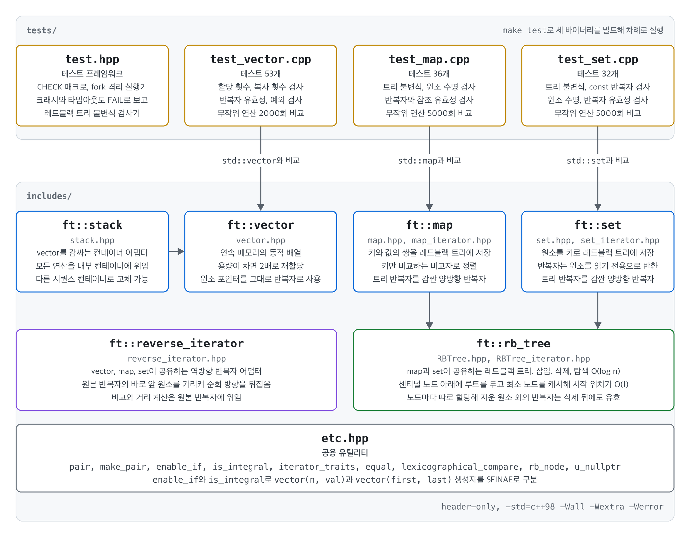

# ft_containers

C++98로 STL의 `vector`, `stack`, `map`, `set` 클래스를 구현하는 [42서울 과제](docs/subject.md)입니다.

`vector`는 배열을 이용한 동적 배열을, `map`과 `set`은 직접 구현한 레드블랙 트리를 내부 자료구조로 사용합니다.


## 아키텍처 다이어그램

<picture>
  <source media="(prefers-color-scheme: dark)" srcset="docs/architecture-dark.webp">
  
</picture>


## 디렉터리 구조

```
ft_containers/
├── includes/
│   ├── vector.hpp              ft::vector
│   ├── stack.hpp               ft::stack (vector 기반 어댑터)
│   ├── map.hpp                 ft::map
│   ├── set.hpp                 ft::set
│   ├── RBTree.hpp              map과 set이 공유하는 레드블랙 트리
│   ├── RBTree_iterator.hpp     트리 양방향 반복자
│   ├── map_iterator.hpp        트리 반복자를 감싸는 map 반복자
│   ├── set_iterator.hpp        트리 반복자를 감싸는 set 반복자
│   ├── reverse_iterator.hpp    역방향 반복자 어댑터
│   └── etc.hpp                 pair, rb_node, enable_if, is_integral, iterator_traits, 비교 알고리즘
├── tests/
│   ├── test.hpp                테스트 프레임워크 (CHECK 매크로, fork 격리 실행기, 레드블랙 트리 검사기)
│   ├── test_vector.cpp         vector 테스트 53개
│   ├── test_map.cpp            map 테스트 36개
│   └── test_set.cpp            set 테스트 32개
├── src/
│   └── main.cpp                std와 ft를 바꿔 끼워 실행 시간을 재는 벤치마크
├── docs/
│   ├── subject.md              과제 설명서 한글 번역
│   ├── subject-rb-tree.webp    과제 설명서의 레드블랙 트리 그림
│   ├── architecture-light.webp 아키텍처 다이어그램 (밝은 테마)
│   └── architecture-dark.webp  아키텍처 다이어그램 (어두운 테마)
└── Makefile                    test, bench, all, clean, fclean, re
```

## 실행 방법

`-std=c++98`을 지원하는 C++ 컴파일러(clang 또는 gcc)와 `make`가 필요합니다. 
모든 소스는 `-Wall -Wextra -Werror -std=c++98`옵션으로 컴파일됩니다.

### 빌드

```sh
make
```

`src/main.cpp`를 `ft` 컨테이너로 빌드해 벤치마크 바이너리 `ft_containers`를 만듭니다. 컨테이너 자체는 헤더 템플릿이라 따로 빌드할 것이 없습니다.

### 라이브러리로 사용하는 법

`includes/`를 include 경로에 넣고 필요한 헤더를 include합니다. 각 헤더가 자기 의존성을 모두 include하므로 쓰는 컨테이너의 헤더만 include하면 되고, `ft::pair`와 `ft::make_pair`는 `map.hpp`와 함께 include됩니다.

```cpp
// example.cpp
#include <deque>
#include <iostream>
#include <string>

#include "map.hpp"
#include "set.hpp"
#include "stack.hpp"
#include "vector.hpp"

int main() {
  ft::vector<int> v;
  for (int i = 0; i < 5; ++i)
    v.push_back(i * i);
  v.insert(v.begin() + 1, 42);

  ft::map<std::string, int> m;
  m["one"] = 1;
  m.insert(ft::make_pair(std::string("two"), 2));

  ft::set<int> s(v.begin(), v.end());

  ft::stack<int> st;                    // 기본 내부 컨테이너는 ft::vector<int>
  ft::stack<int, std::deque<int> > dq;  // 다른 컨테이너도 끼울 수 있습니다
  st.push(7);
  dq.push(8);

  for (ft::vector<int>::iterator it = v.begin(); it != v.end(); ++it)
    std::cout << *it << ' ';
  std::cout << '\n';
  for (ft::map<std::string, int>::iterator it = m.begin(); it != m.end(); ++it)
    std::cout << it->first << '=' << it->second << ' ';
  std::cout << '\n';
  std::cout << s.size() << ' ' << *s.rbegin() << ' ' << st.top() << ' ' << dq.top() << '\n';
  return 0;
}
```

```sh
// 실행
c++ -Wall -Wextra -Werror -std=c++98 -I ft_containers/includes example.cpp -o example && ./example
```

```sh
// 출력
0 42 1 4 9 16
one=1 two=2
6 42 7 8
```

### 테스트

```sh
make test
```

`tests/test_*.cpp`를 `build/tests/` 아래에 각각 빌드한 뒤 순서대로 실행합니다. 테스트마다 자식 프로세스에서 격리 실행되므로, 검사 실패뿐 아니라 크래시와 타임아웃도 FAIL로 보고됩니다.

Suite 하나만 실행하려면 바이너리를 직접 빌드합니다.

```sh
make build/tests/test_vector && ./build/tests/test_vector
```

### 벤치마크

```sh
make bench
```

`src/main.cpp`를 `USE_STL=1`(std)과 `USE_STL=0`(ft)로 각각 빌드해 실행하고 `time`으로 실행 시간을 비교합니다. 

약 4GB 크기로 `vector`를 채우고 `map`에 약 100만 개를 넣으므로 메모리 여유가 있을 때 실행하세요. 과제 기준은 `ft`의 실행시간이 `std` 실행시간의 20배 이내면 통과입니다.
